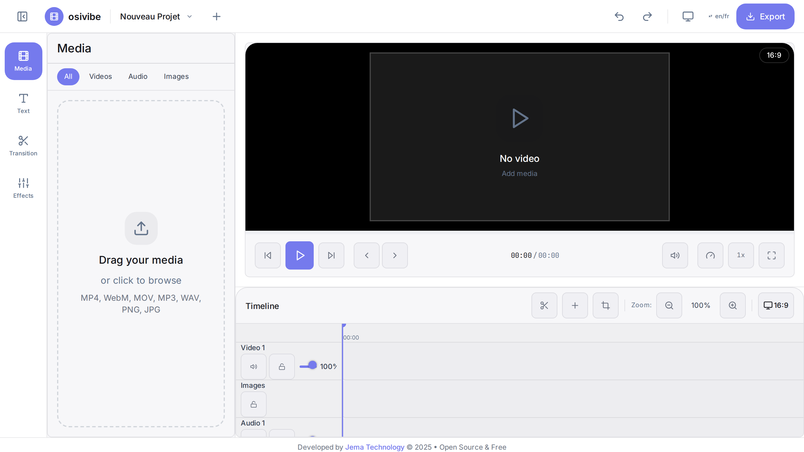
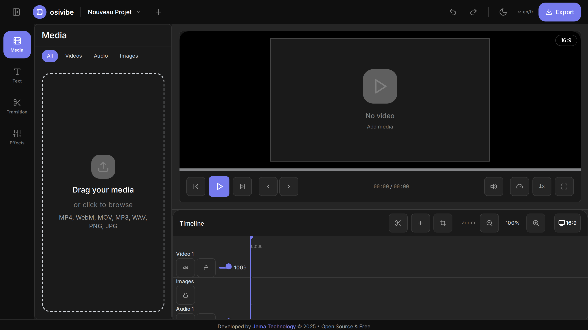

<div align="center">

<h1>🎬 OsiVibe</h1>

### Professional video editing, right in your browser

[](https://www.jematechnology.fr)
[](LICENSE)
[](https://react.dev)
[](https://www.typescriptlang.org)
[](https://vitejs.dev)
[](https://tailwindcss.com)
[](#-supported-devices)
[](#-contributing)

**Timeline editing · transitions · effects · text · hardware-accelerated export** — no installation, no upload.

[Features](#-features) · [Screenshots](#-screenshots) · [Getting started](#-getting-started) · [Tech stack](#-tech-stack) · [License](#-license)

</div>



---

## 🎯 About

OsiVibe is a modern, browser-based video editor built for performance and accessibility. It runs seamlessly from foldable phones to desktop computers, bringing professional editing to everyone, everywhere.

## ✨ Features

| Feature | Description |
| --- | --- |
| 🎬 **Timeline editing** | Intuitive drag-and-drop timeline for arranging clips |
| 🎨 **Modern UI** | Clean, dark-themed interface with smooth animations |
| 🔄 **Transitions** | Built-in transition effects between clips |
| 🔤 **Text & titles** | Add captions and titles on top of your video |
| ✨ **Effects** | Fine-tune clip properties, filters and effects |
| 📤 **Export** | Multiple formats and quality presets |
| 🖥️ **Hardware detection** | Automatic GPU/CPU optimization for encoding |
| 📚 **Media library** | Organized media management (video, audio, images) |
| ⚡ **Media Bunny engine** | Instant media loading and zero-latency playback |

**Key highlights:** free & open source, browser-based (no install), fully responsive, installable as a PWA.

---

## 📸 Screenshots

| Light | Dark |
| :---: | :---: |
|  |  |

---

## 📱 Supported devices

OsiVibe ships a comprehensive responsive system built for modern devices:

| Category | Devices |
| --- | --- |
| **Foldables** | Galaxy Z Fold 5/6, Honor Magic V3, Oppo Find N3, Pixel Fold |
| **Smartphones** | iPhone 15 Pro Max, iPhone SE, Galaxy S24, Pixel 8 |
| **Tablets** | iPad Pro/Air/Mini, Galaxy Tab |
| **Desktop** | Chrome, Firefox, Safari, Edge |

Breakpoints:

```
fold-cover: 272px │ xs: 375px │ sm: 428px │ fold-inner: 512px
md: 768px │ lg: 1024px │ xl: 1280px │ 2xl: 1536px
```

---

## 🚀 Getting started

### Prerequisites

- [Node.js](https://nodejs.org) 18+
- npm

### Development

```bash
git clone https://github.com/JemaOS/osivibe.git
cd osivibe
npm install
npm run dev
```

### Build & preview

```bash
npm run build       # production build
npm run preview     # preview locally
```

### Tests

```bash
npm test            # unit tests (Vitest)
npm run test:e2e    # end-to-end tests (Playwright)
```

---

## 🔧 Tech stack

- **React 18** + **TypeScript**
- **Vite** build tooling
- **TailwindCSS** styling
- **Zustand** state management
- **Media Bunny** + **FFmpeg WASM** for decoding/encoding
- **Vitest** + **Playwright** for tests

---

## 🤝 Contributing

Contributions are welcome! Fork, branch, and open a pull request.

```bash
git checkout -b feat/my-feature
git commit -m "feat: my feature"
git push origin feat/my-feature
```

---

## 📄 License

Released under the **MIT License** — see [LICENSE](LICENSE).

<div align="center">
Made with ❤️ by <a href="https://www.jematechnology.fr">Jema Technology</a>
</div>
